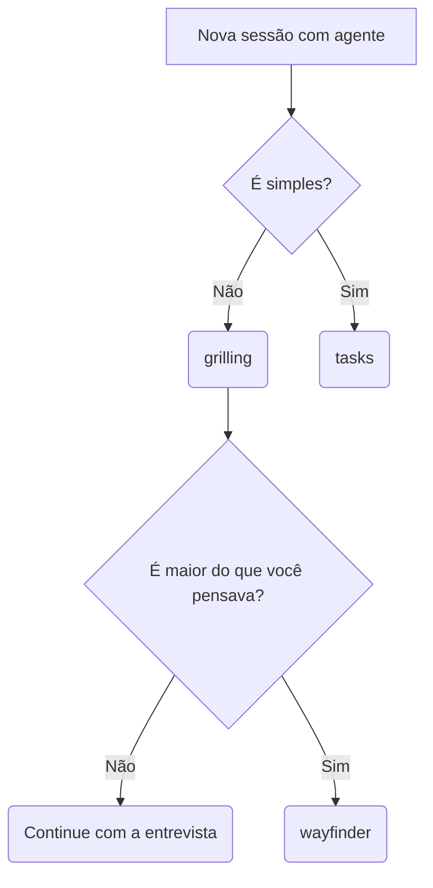

# skills

Skills para Claude Code e Codex: um fluxo de trabalho de software que vai do planejamento à retrospectiva, mais o vocabulário compartilhado em que esse fluxo é escrito. Cada skill é um diretório em `skills/` com um `SKILL.md`, que o agente lê, e um `README.md`, para humanos.

## Instalação

O `sync.sh` cria symlinks de cada diretório de skill em `~/.claude/skills/` e `~/.codex/skills/`, e do `AGENTS.md` do repositório em `~/.claude/CLAUDE.md` e `~/.codex/AGENTS.md`:

```sh
./sync.sh
```

O diretório da skill é linkado inteiro, então editar uma skill aqui muda nas duas ferramentas de uma vez.

## O fluxo

Ponto de entrada: as skills de planejamento `grilling` ou `wayfinder`. Ou nenhuma! Simplesmente converse com o seu agente predileto.

Se o que você quer fazer é simples e direto, invoque a skill `tasks` e explique o que você quer resolver. Depois implemente com o ciclo das skills `implement` e `review`.

A `wayfinder` foi feita para planejar tarefas muito grandes, e a pior coisa que pode acontecer é você criar o mapa completo, fazer múltiplas sessões de grilling e descobrir que a solução era simples. Trate ela como caso de exceção, ou se tem certeza que o seu problema requer todo esse nível de planejamento.
(Ex: `/wayfinder Quero construir um foguete para ir à Lua. Não cometa erros.`).

Na dúvida, comece com a `grilling`, que apesar de ter invocação automática pode ser chamada diretamente com `/grilling`. Se você genuinamente nunca ouviu falar da skill `grilling` ou `grill-me`, vá conhecer quem é [Matt Pocock](https://www.youtube.com/@mattpocockuk).



Como eu faço a maior parte do meu desenvolvimento:
- Nova sessão com um agente: `/grilling Eu quero resolver/fazer ...`
- Depois da entrevista, mas ainda na mesma sessão, eu invoco a skill `feature` para consolidar o problema e a solução em um documento de especificação (SPEC.md).
- Em uma nova sessão eu rodo `/tasks docs/features/<nome-da-feature>/SPEC.md`. Isso gera as tarefas dentro do diretório da feature.
- Para cada tarefa eu faço o ciclo de desenvolvimento abaixo.

### Desenvolvimento

O core do desenvolvimento são as skills `implement` e `review`. Para começar a rodar a `implement` é necessário ter uma task que pode estar avulsa ou fazer parte de uma feature.

```text
tasks ──▶ implement ◀──▶ review
(arquivos    (PR)        (comentário)
 de task)      │
               │ merge
       ┌───────┴───────┐
       ▼               ▼
     retro         follow-ups
 (toda task)    (última task da feature)
       │               │
       ▼               ▼
 edições em skills,   tasks
 steering, tasks
```

Em uma sessão nova eu rodo a implement apontando para uma task: `/implement docs/features/<nome-da-feature>/tasks/01-first-task.md`.

O agente vai desenvolver usando as skills `tdd` e `codebase-design`. Dentro da `tdd` é um bom lugar para colocar exemplos de testes e mocks da sua linguagem favorita. Ironicamente esse repo usa TypeScript, que não é a minha favorita.

A skill `implement` vai seguir até abrir um PR, e nesse ponto eu abro uma nova sessão - sem fechar a sessão do agente que implementou - e rodo a `review` apontando para o número do PR.

Quando a review é postada eu informo diretamente o agente desenvolvedor, que vai avaliar e corrigir qualquer ponto levantado e espero a resposta dele no PR. Você pode levantar seus próprios pontos de correção.

Quando o desenvolvedor posta a resposta dele eu tomo uma de duas decisões:
- Aprovar o PR, falando diretamente com o desenvolvedor que ele pode mergear
- Rodo uma nova review, com um novo agente. A sessão do agente que fez a primeira review pode ser encerrada.

Repito até mergear.

### Melhoria do processo

Após mergear um PR e finalizar uma task, seja de uma feature ou avulsa, eu sempre rodo a skill `retro`. Ela analisa o processo em si, melhorando skills e scripts. É de onde vem a minha maior economia de tokens com agentes até o momento. Recomendo.

### Follow-ups

Quando eu termino a última task de uma feature, após rodar a `retro` eu rodo também a `follow-ups`. O papel dela é achar tarefas que ficaram para trás em todos os PRs da feature. Isso pode acontecer por diversos motivos, o mais comum é o revisor levantar algo válido, mas o desenvolvedor adiar por fugir ao escopo da tarefa.

### Melhorias de code base

A cada semana (ou quando eu lembro) eu rodo a skill `improve-codebase-architecture`. Ela também é indicada caso você tenha vibe-codado um projeto de forma insana e não sabe por onde começar a melhorar ele. Ela mostra de forma visual como começar a montar módulos profundos ([John Ousterhout, "A Philosophy of Software Design"](https://www.amazon.com.br/Philosophy-Software-Design-2nd/dp/173210221X)).

## Skills de invocação manual

Invocadas pelo nome (`/nome`); o agente nunca as dispara sozinho.

| Skill | O que faz |
| --- | --- |
| [wayfinder](skills/wayfinder/README.md) | Planeja trabalho grande demais para uma sessão como um mapa de tickets de decisão, resolvidos um por sessão, e depois um roadmap de features |
| [improve-codebase-architecture](skills/improve-codebase-architecture/README.md) | Varre a base de código em busca de oportunidades de aprofundamento, apresenta um relatório HTML e faz grilling sobre a escolhida |
| [feature](skills/feature/README.md) | Consolida a conversa atual em uma spec de feature em `docs/features/<nome>/SPEC.md` |
| [tasks](skills/tasks/README.md) | Quebra uma conversa, plano ou spec em tasks do tamanho de uma sessão, após um corte adversarial feito por um sub-agente |
| [implement](skills/implement/README.md) | Implementa uma task com testes primeiro, por meio de um PR revisado pelo usuário até o merge |
| [review](skills/review/README.md) | Revisa um PR em dois eixos, Standards e Spec, e publica um único comentário |
| [follow-ups](skills/follow-ups/README.md) | Depois da última task de uma feature, caça os pontos adiados nos PRs e os triagem em tasks ou descartes |
| [retro](skills/retro/README.md) | Retrospectiva do ciclo por trás de um PR mergeado, propondo uma edição no arquivo dono de cada achado |

## Skills de invocação automática

O agente as carrega sozinho quando o gatilho aparece, e as skills do fluxo as carregam pelo vocabulário.

| Skill | O que faz |
| --- | --- |
| [grilling](skills/grilling/README.md) | Entrevista o usuário implacavelmente sobre um plano ou decisão, uma pergunta por vez, até um entendimento compartilhado |
| [codebase-design](skills/codebase-design/README.md) | Vocabulário e princípios compartilhados para projetar módulos profundos em seams limpos |
| [domain-modeling](skills/domain-modeling/README.md) | Mantém o glossário e os ADRs do projeto afiados durante o design |
| [tdd](skills/tdd/README.md) | O ciclo red → green, uma fatia por vez, todo teste em um seam confirmado |
| [show-me](skills/show-me/README.md) | Mostra um ponto visualmente com a menor vista que o deixa claro |
| [writing-for-agents](skills/writing-for-agents/README.md) | Como escrever skills, arquivos de steering e qualquer documento que um agente lê |

## Créditos

Estas skills são fortemente baseadas no trabalho de [Matt Pocock](https://github.com/mattpocock/skills) com menção honrosa a [Dex Horthy](https://github.com/humanlayer/skills).

Outros repositórios de skills que valem a menção: [Emil Kowalski](https://github.com/emilkowalski/skills) e [Lauren Tan (poteto)](https://github.com/cursor/plugins/tree/main/pstack/skills).
