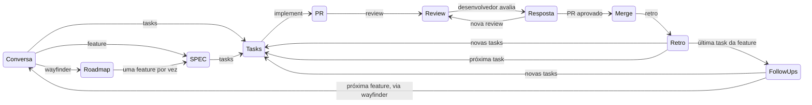

# O fluxo

Este documento descreve o fluxo de trabalho completo das skills deste repositório como uma máquina de estados: em cada estado, qual skill se invoca, em que sessão, com qual prompt, e o que decide a transição seguinte. A visão geral e a tabela das skills estão no [README](README.md); aqui estão os detalhes de operação.

Duas regras valem em todos os estados:

- **Planejar na mesma sessão, executar em sessão nova.** As skills de planejamento (`grilling`, `wayfinder`, `feature` e `tasks` quando a fonte é a conversa) trabalham sobre a conversa em curso e por isso ficam na sessão em que ela aconteceu. As skills de execução (`tasks` a partir de uma SPEC, `implement`, `review`, `retro`, `follow-ups`) rodam cada uma em uma sessão nova, porque a entrada delas está em arquivos ou no PR. A única sessão de execução que vive mais de uma etapa é a do desenvolvedor, que nasce na `implement` e morre no merge.
- **Uma task por vez.** Planejamento (features, mapas, tasks avulsas) pode nascer em paralelo, mas o desenvolvimento é serializado.

## Visão geral

## Etapas

| Estado | Skill | Sessão | Prompt | Entrada | Saída | Quem decide a transição |
| --- | --- | --- | --- | --- | --- | --- |
| Conversa | nenhuma, `grilling` ou `wayfinder` | nova | `Eu quero resolver ...`, `/grilling ...`, `/wayfinder ...` ou `/wayfinder <MAP>` para abrir a próxima feature de um roadmap | um problema, ou um mapa com feature `planned` | entendimento compartilhado, ou um mapa e um `ROADMAP.md`, ou a próxima feature `in-progress` com a conversa pronta para a `feature` | você: invoca `feature` ou `tasks` quando a conversa amadurece |
| SPEC | `feature` | a mesma da conversa | `/feature` | a conversa | `docs/features/<feature>/SPEC.md` | automática: segue para `tasks` |
| Tasks | `tasks` | nova (ou a mesma da conversa, se não houve SPEC) | `/tasks docs/features/<feature>/SPEC.md` ou `/tasks` | SPEC ou conversa | `docs/features/<feature>/tasks/*.md` ou `docs/tasks/<task>.md` | você: escolhe a próxima task da fila |
| PR | `implement` | nova, a do **desenvolvedor** | `/implement docs/features/<feature>/tasks/01-first-task.md` ou `/implement docs/tasks/<task>.md` | um arquivo de task | um PR aberto | automática: todo PR aberto recebe uma review |
| Review | `review` | nova, a do **revisor**, uma por review | `/review #<pr>` | o PR | um comentário no PR | automática: avisar o desenvolvedor |
| Resposta | `implement` | a do desenvolvedor | `Eu adicionei uma review, pode avaliar` | o comentário da review | correções e resposta no PR | você: aprova ou pede nova review |
| Merge | `implement` | a do desenvolvedor | `PR aprovado, pode mergear` | sua aprovação | PR mergeado; a sessão do desenvolvedor acaba | automática: toda task mergeada passa pela `retro` |
| Retro | `retro` | nova | `/retro #<pr>` | o PR mergeado | edições em skills, steering e checks; às vezes tasks novas | automática: tasks novas entram na frente da fila |
| Follow-ups | `follow-ups` | nova | `/follow-ups docs/features/<feature>/SPEC.md` | a SPEC e todos os PRs da feature | tasks novas ou descartes | automática: tasks novas entram na frente da fila |

## O ciclo de desenvolvimento em detalhe

1. **Implementar.** Em uma sessão nova, `/implement <task>`. O desenvolvedor segue até abrir o PR e fica esperando. Não encerre essa sessão.
2. **Revisar.** Em outra sessão nova, `/review #<pr>`. Quando a review é publicada, a sessão do revisor pode ser encerrada: cada review é um agente fresco, sem memória da anterior.
3. **Responder.** De volta ao desenvolvedor: `Eu adicionei uma review, pode avaliar`. Ele corrige, responde no PR e espera. Você pode adicionar os seus próprios pontos antes de avisar.
4. **Decidir.** Lendo a resposta, uma de duas saídas:
   - `PR aprovado, pode mergear`: o desenvolvedor faz o merge e a sessão dele acaba.
   - Voltar ao passo 2 com um revisor novo.
5. **Retro.** Em uma sessão nova, `/retro #<pr>`, para toda task mergeada, avulsa ou de feature.
6. **Follow-ups.** Só se a task era a última de uma feature, e depois que as tasks criadas pela retro foram mergeadas: em uma sessão nova, `/follow-ups <SPEC>`.

## A fila de tasks

A fila é um conjunto de arquivos de task ainda não mergeados, e a regra de prioridade é:

1. Tasks criadas pela `retro` ou pela `follow-ups` do ciclo que acabou de fechar. Elas corrigem o ambiente ou pagam uma dívida da feature, e passam pelo mesmo ciclo `implement` e `review` antes de qualquer outra coisa.
2. A próxima task da feature em andamento, na ordem numerada em `tasks/`.
3. Tasks avulsas em `docs/tasks/`.
4. A próxima feature `planned` do `ROADMAP.md`, começando pelo estado Conversa: `/wayfinder <MAP>` abre a feature (carrega as decisões dos tickets e a SPEC anterior, marca `in-progress`, faz grilling) e entrega a conversa à `feature`, que escreve a SPEC; só então vem `tasks`.

Uma task avulsa fecha o ciclo na `retro`. Uma feature fecha quando a `follow-ups` da última task não gera tasks novas, ou quando todas as que gerou foram mergeadas. Um roadmap fecha quando todas as suas features fecharam.
